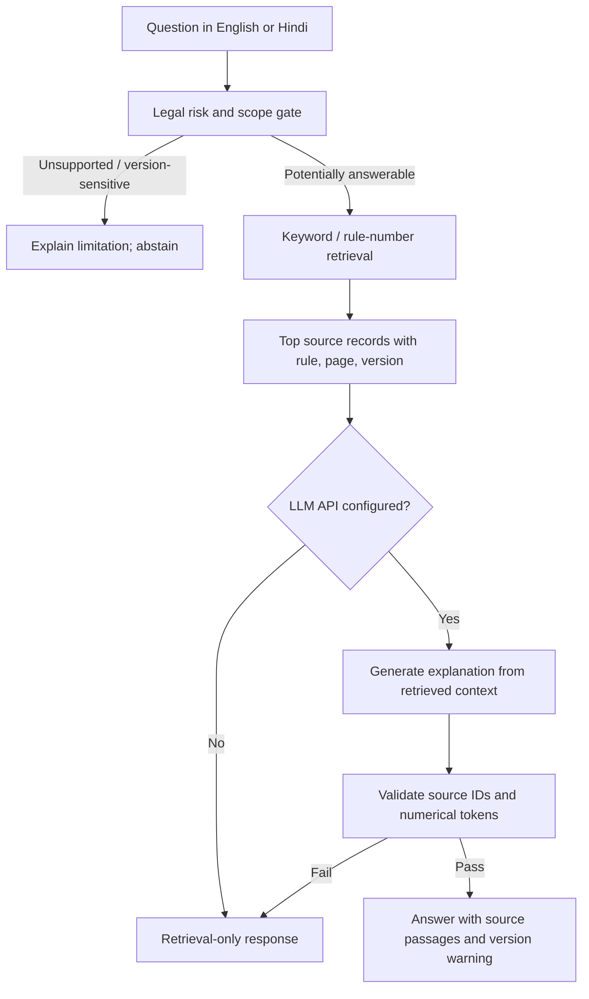

# NiyamSetu

**Every Answer Backed by a Rule.**  
A correctness-first, optional LLM-powered RAG prototype for finding provisions in the Madhya Pradesh Bhumi Vikas Rules, 2012.

> **Important:** NiyamSetu is an independent prototype, not a government service or legal advice. The bundled source material is consolidated to 6 March 2025, and the project has not verified all later amendments. It deliberately labels answers as historical evidence and refuses to state a definitive current-law conclusion when an unresolved amendment may apply.

## Features

- **Retrieval-augmented generation (RAG):** retrieve source records before calling an LLM; send only retrieved context to the configured model.
- **OpenAI-compatible chat API:** configured by environment variables. DeepSeek is the default provider configuration; compatible hosted or local endpoints can be substituted.
- **No-key fallback:** search and evidence lookup still work without an LLM key. The UI reports whether the model is enabled and does not pretend retrieval-only answers are AI-generated.
- **Source-grounded output:** model must return source IDs from the retrieved set. Code validates citation IDs and rejects numerical values not present in the question or cited text. The UI displays supporting source passages and PDF links.
- **Legal-version safeguards:** historical-only source labels; explicit amendment watchlist; current-law sensitive queries are stopped before the LLM call when legal status is unresolved.
- **Hindi query expansion:** a small fixed glossary expands common Hindi building-rule terms for retrieval. Hindi generation depends on the configured LLM and must be evaluated by a fluent speaker before practical use.
- **Dataset import:** load the event-provided full JSONL file through the UI or the explicit download script.
- **Automated tests:** search, abstention, source references, RAG routing, citation validation, numeric guard, and provider-disabled behaviour.

## Quick start (Windows / macOS / Linux)

Requires Python 3.10+; runtime uses the Python standard library only.

```bash
python app.py
```

Open <http://127.0.0.1:8000>.

Run automated tests:

```bash
python -m pytest -q
```

No API key is needed for the retrieval-only mode.

## Enable LLM-powered RAG

1. Copy `.env.example` to `.env`.
2. Add a valid key to `NIYAMSETU_API_KEY`.
3. Restart `python app.py`.

Default configuration:

```dotenv
NIYAMSETU_API_KEY=your_key_here
NIYAMSETU_LLM_BASE_URL=https://api.deepseek.com
NIYAMSETU_LLM_MODEL=deepseek-flash
NIYAMSETU_LLM_TIMEOUT=35
NIYAMSETU_LLM_PROVIDER_LABEL=DeepSeek
```

The app calls `<NIYAMSETU_LLM_BASE_URL>/chat/completions`, using the configured `model` and a Bearer API key. The defaults follow DeepSeek's current API documentation: <https://api-docs.deepseek.com/api/create-chat-completion/> and <https://api-docs.deepseek.com/>. You can configure another provider only if it supports a compatible chat-completions request and JSON response format; set the base URL, model and API key accordingly.

**Privacy:** When LLM mode is enabled, the user's question and retrieved legal text are sent to the configured LLM provider. Do not enter citizen names, personal information, full addresses, property identifiers, or other sensitive details. Keep `.env` private; it is ignored by Git. The API key is never exposed in the health endpoint or browser UI.

## Load the complete event dataset

The ZIP/repository bundles only a handful of demo excerpts so it can run immediately. For broad retrieval, fetch the full JSONL from the public event reference repository:

```bash
python scripts/download_dataset.py
```

This script downloads only the event-provided dataset from GitHub, validates that each non-empty JSONL line has a rule ID and text, backs up a prior downloaded dataset, and saves it at `data/bhumi_vikas_rules.jsonl`. It does **not** verify legal freshness or authoritative accuracy. Alternatively, choose the file in the UI and click **Validate & load JSONL**.

Reference data and source documents: <https://github.com/Vishal4742/bhopal-impact-lab-2026-problem-statements/tree/main/track-1-bhumi-vikas-sahayak>

## Architecture



This MVP uses lexical retrieval, not embeddings. It can still be RAG: retrieved source text is supplied to the LLM as context before answer generation. The retrieval method is intentionally simple because the event corpus is small and table/version correctness is more important than adding a vector database.

## Legal source freshness and limitations

- Base source: [M.P. Bhumi Vikas Rules, 2012 — consolidated text up to 6 March 2025](https://www.mptownplan.gov.in/NewsPDF/bvn06032025E.pdf). A verified local copy is served at `/api/pdf`.
- Department rule listing: <https://mptownplan.gov.in/rule.aspx>. (Note: the official host has a TLS certificate issue; see `data/legal_sources.json` for details.)
- Reported 28 August 2026 amendment to Rule 2(5)(c): [secondary report](https://teamleaseregtech.com/updates/article/59469/government-of-madhya-pradesh-amendment-to-land-development-rules/). The app's watchlist marks this pending official verification because the primary notification/effective date was not verified for this project.
- A secondary source also reports a December 2025 item concerning Rule 5(6)/Appendix-M; see `data/legal_sources.json` for its status and source URL.

The application does not fetch the latest legal rules automatically and does not connect to live government systems. No provision is labelled verified current law merely because it appears in the bundled or imported file. The JSONL is a derived index, not the legal source of truth. A valid quotation match proves only that text occurs in the local data; it does not establish that the quote fully supports a legal conclusion or is currently in force.

### Important safeguards and remaining work

1. A pending/conflicting source status blocks LLM generation for version-sensitive questions.
2. The model's citations must reference the retrieved set; unmatched IDs fail validation.
3. Numerical tokens in generated answers must occur in the question or cited source text; otherwise the app falls back to retrieval-only output.
4. Semantic legal support is not automatically proven by those checks. A domain expert still needs to review all answers before real-world use.
5. Fee calculations, complex setbacks and general permit eligibility are not offered unless a particular source table and scope have been independently verified.
6. The bundled excerpts are not the complete rulebook. Download/import the full JSONL for wider search coverage, while retaining the historical-version warning.
7. This app is intended for a local demo, not deployment directly on a public network. If deployed, add authentication, rate limiting, CSRF protections, privacy controls, stronger request limits, and provider-side usage monitoring.

## Demo queries

- `What does Rule 56 say about residential buildings?`
- `I want a farm house on agricultural land. What minimum plot size and maximum FAR are listed in Rule 17?`
- `How far must a building stay from low-voltage overhead electric lines according to the supplied Rule 52 excerpt?`
- `Do I need separate development permission for a 300 sq m plot in 2026?` — expected to trigger the unresolved legal-version guard rather than an AI-generated legal conclusion.
- `How do I pay property tax online?` — expected to abstain because this is outside the supplied rule set.

## License

MIT; see `LICENSE`.

## Deploying to Render

- Blueprint: `render.yaml` (Web Service, Python 3.13.7, free plan). Build: `python scripts/check_dataset.py` (fails if `data/bhumi_vikas_rules.jsonl` is missing or not 106 records). Start: `python app.py`. Health check: `/healthz`.
- The app binds `0.0.0.0` and reads Render's `PORT`. No third-party packages are needed at runtime (`boto3` is only for the optional Bedrock path).
- The full dataset is committed to Git (it is no longer git-ignored). Make sure `data/bhumi_vikas_rules.jsonl` and `data/bvn06032025E.pdf` are pushed.
- Set `NIYAMSETU_API_KEY` in the Render dashboard (never in Git). Without it the app runs in retrieval-only mode.
- `/api/import` is disabled unless `NIYAMSETU_ENABLE_IMPORT=1`; leave it off on a public service.
- The supplied rules remain historical and not fully verified; the official PDF host has had TLS/404 problems, so the bundled local copy is served at `/api/pdf`.
